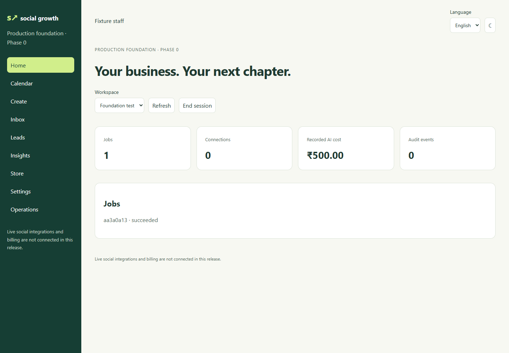

# Social Growth Agent

An India-focused social-to-revenue SaaS proposal, feature catalogue, competitor investigation, and runnable local reference implementation.

Public repository: [Raghav08032007/social-growth-agent](https://github.com/Raghav08032007/social-growth-agent).

**Delivery status:** planning package + local demo. This is not a production SaaS or a complete replica of Whop, Buffer, Hootsuite, Sprout Social, or Agorapulse. All 257 catalogue features remain planned. The demo implements a subset of their underlying workflow using simulated publishing and manually recorded sales.

**Implementation is underway:** the Phase 0 Flask/MySQL/Redis/Celery foundation and React shell now live in `services/api/` and `frontend/`. See [foundation setup](docs/foundation-setup.md) and the [phase report](docs/reports/phase-0.md). The original catalogue preserves source-plan status; the phase report tracks current implementation and evidence.



## Run the demo

Requires Python 3.11+; no third-party packages or provider credentials.

```powershell
python -m backend.server
```

Open http://127.0.0.1:8000. Data persists locally in SQLite. The server binds to loopback only. Workspace switching is a demo mechanism, not authentication. Do not expose it publicly or enter customer data.

```powershell
python -m unittest discover -s backend -p "test_*.py" -v
python scripts/validate_catalogue.py
```

## Read in this order

1. [Product blueprint](docs/BLUEPRINT.md): customer, positioning, scope and decisions.
2. [Competitor investigation](docs/competitors.md): advertised capabilities and REA evidence boundaries.
3. [Feature guide](docs/FEATURE_GUIDE.md) and [257-feature CSV](docs/features.csv).
4. [Delivery roadmap](docs/roadmap.md), [launch specification](docs/launch-spec.md), [architecture](docs/architecture.md).
5. [Connector capability gates](docs/connectors.md), [verification plan](docs/verification.md), [operations](docs/operations.md).
6. [Financial assumptions](docs/economics.md), [project ratings](docs/scorecard.md), [source audit](docs/source-audit.md).
7. [Current delivery report](docs/delivery.md) and [GitHub publication](docs/github.md).

## What can be tried locally

Create a draft, approve it, simulate publishing, associate a lead, record an INR sale, refund it, and inspect the revenue ledger and audit trail. The app provides separate overview, content, leads, revenue and roadmap views. See the delivery report for verification results and limitations.

## Production direction

React/Vite/TypeScript frontend; Flask API; MySQL; Redis/Celery; object storage; official provider adapters. The dependency-free demo is an executable specification and must not become the public server. Production work begins with P0 infrastructure and access controls, followed by a deliberately smaller pilot slice. No competitor assets, branding or private backend code are reused.

## Public repository hygiene

Raw competitor captures and the original private attachment are excluded from Git and distribution archives. The derived findings preserve evidence IDs. No license granting reuse is selected yet; choose one deliberately before accepting external contributions.
