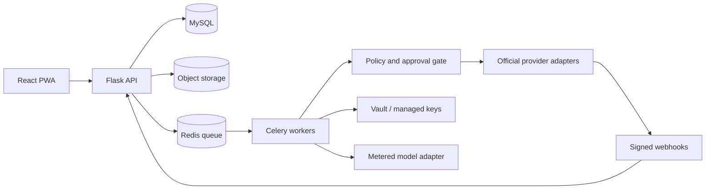

# Production architecture specification

This is a proposed target. The current demo uses stdlib HTTP + SQLite and does not implement this architecture.

## Boundaries

Use a modular monolith: identity, workspaces, connections, business profiles, content, approvals, publishing, inbox, leads, commerce, attribution, billing, agents and operations. Flask Blueprints own HTTP handlers; services own transactions and policy; repositories require workspace context; Celery tasks receive tenant-scoped identifiers and reauthorize before side effects. React/Vite uses TypeScript, query caching and i18n; public store/review pages render with escaped templates.

Identity is server authenticated. Never trust a client-supplied workspace ID as authorization. Membership grants a role per workspace. Staff access uses a separate privileged path with recorded reason. API keys/OAuth scopes are additive limits, not replacements for tenant checks. Enforce tenant ownership in database constraints, jobs, exports, storage keys, cache keys and signed review links.

## Core data

| Aggregate | Main records and invariants |
|---|---|
| Identity | users, workspaces, memberships, sessions; unique member/workspace |
| Connections | connected_accounts, scope_grants, encrypted_tokens, token_versions; revoke and rotate |
| Business | profiles, profile_versions, brand_assets, playbooks; field provenance/confidence |
| Content | posts, variants, assets, approvals, publish_attempts; approve exact immutable version |
| Inbox | raw_events, conversations, messages, contact_links, consent_events; event dedupe and verified identities |
| Leads | leads, stages, notes, source_links; known workspace post/contact references |
| Commerce | orders, payment_events, refunds, attribution_events, ledger_entries; integer minor units/currency |
| Operations | outbox, job_runs, audit_events, credit_entries, caps, feature_flags; append-only usage |

Use composite unique keys and tenant-aware references where supported, plus service checks and negative tests. Index workspace/time/status and provider/event ID lookups. Retention, deletion and redaction requirements are designed per record type. Immutable money entries can be retained with personal fields removed where appropriate to the reviewed retention policy.

## State machines

Post: draft → pending review → approved(version hash) → scheduled → publishing → published / failed / unknown. Edits invalidate approval. Unknown provider outcome triggers reconciliation before retry. A scheduler uses UTC internally and renders Asia/Kolkata; rescheduling uses version checks to avoid races.

Payment: received → signature verified → normalized → reconciled → ledger recorded. Duplicate deliveries are acknowledged without repeating value. Refunds/chargebacks append negative entries tied to the original payment and cannot exceed settled amount. Refund-before-payment and out-of-order deliveries wait for reconciliation rather than inventing a sale.

## Side effects

Write domain changes and an outbox record in one transaction. Workers claim records with leases; maintain deterministic idempotency keys and provider request/result references. Retry transient errors using bounded exponential backoff and jitter. Expired authorization requires reconnect; invalid content requires edits; forbidden actions do not retry. Dead-letter queues have owner, alert, safe replay and audit evidence. “Exactly once” is an application accounting invariant, not a promise about provider delivery.

## AI and costs

Version prompts and output schemas. Separate untrusted customer messages from instructions. Models propose; deterministic code authorizes. Reserve credits before calls and settle actual usage after; release unused reservations. Cap concurrent calls to prevent budget races. Agent tools require workspace, role, action allowlist, approval version, consent/eligibility and remaining budget. Kill switch is checked immediately before each outbound effect. Mask personal data in logs and use reviewed retention for prompts.

## Deployment

Docker Compose for development (MySQL, Redis, API, worker, scheduler, storage emulator, mail catcher). Managed production database/backups; separate API and worker processes; one scheduler lease. TLS ingress, explicit allowed hosts/origins, CSRF protection for cookie auth, secure sessions, schema validation and upload limits. CI runs meaningful unit, integration and browser tests plus migration upgrade/rollback verification. Deployment requires backup, reversible schema rollout, health check and rollback procedure.

Set performance objectives only with measurement: proposed p95 API <300 ms for indexed reads at 10k posts/workspace and usable mobile app <2.5 s on a specified 4G profile. Include background reconciliation lag and queue age; do not substitute a 100-user browser test for capacity planning.
